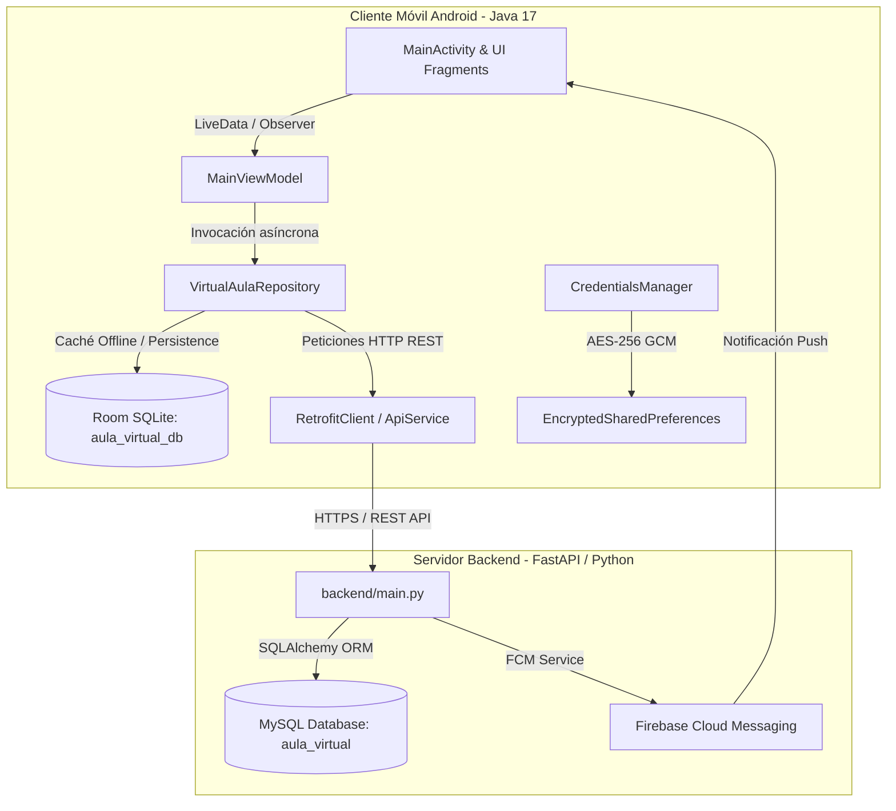

# Documentación Técnica Maestro: Aula Virtual

¡Bienvenido al índice general de la documentación técnica del sistema **Aula Virtual**!

Esta documentación técnica abarca la totalidad del sistema (Cliente Android nativo en Java 17 + Backend REST en FastAPI / Python + Base de datos MySQL / Room SQLite).

---

## 1. Archivos de Documentación

| Nº | Documento | Qué encontrarás ahí |
| :---: | :--- | :--- |
| **01** | [Introducción y Arquitectura](01_introduccion_y_arquitectura.md) | Propósito del proyecto, problemas que resuelve, stack tecnológico, versiones, requisitos del sistema y arquitectura MVVM por capas. |
| **02** | [Roles y Permisos](02_roles_y_permisos.md) | Tipos de usuarios (`ADMIN`, `PROFESSOR`, `ENCARGADO`), matriz de permisos, lógica de redirección y cuentas de prueba preinsertadas. |
| **03** | [Autenticación y Seguridad](03_autenticacion_y_seguridad.md) | Flujo de login, almacenamiento cifrado en `EncryptedSharedPreferences` (AES-256), biometría, hashing BCrypt y observaciones de seguridad. |
| **04** | [Modelo de Datos](04_modelo_de_datos.md) | Diagrama Entidad-Relación (ER), detalle de las 20 tablas de MySQL y matriz de correspondencia completa (MySQL ↔ ORM ↔ DTO ↔ Room). |
| **05** | [Backend API (FastAPI)](05_backend_api.md) | Estructura de `main.py`, tabla completa de los +45 endpoints REST, parámetros, respuestas JSON, validaciones y scripts de ejecución con Uvicorn y Cloudflare. |
| **06** | [Datos en Android](06_datos_en_android.md) | Configuración de Retrofit/Gson/OkHttp, interfaces `ApiService`, base de datos local Room (v9), DAOs, entidades y estrategia de sincronización offline/online. |
| **07** | [Repositorios y ViewModels](07_repositorios_y_viewmodels.md) | Funcionamiento del repositorio central `VirtualAulaRepository`, estado de la UI con `MainViewModel` (LiveData) y diagramas de flujo de datos. |
| **08a**| [UI: Pantallas Compartidas](08a_ui_compartida.md) | `MainActivity`, inicio de sesión, perfil de usuario, ajustes, notificaciones, mensajería directa en tiempo real, foros de discusión y calendario académico. |
| **08b**| [UI: Módulo Administrador](08b_ui_administrador.md) | Dashboard de administración, gestión de usuarios, encargados, materias, inscripciones, instalaciones físicas y rejilla cuadrícula de horarios. |
| **08c**| [UI: Módulo Profesor](08c_ui_profesor.md) | Inicio docente, materias asignadas, centro de control de asignaturas, calificaciones, conducta (1-5), toma de asistencia y gestor de Excel POI. |
| **08d**| [UI: Módulo Encargado/Estudiante](08d_ui_estudiante_encargado.md) | Inicio del encargado, selector desplegable de hijos a cargo, dashboard de promedio general, ficha de materias, reporte de asistencia y boleta de conducta. |
| **09** | [Navegación en Android](09_navegacion.md) | Grafo de navegación `nav_graph.xml`, menús laterales del Drawer por rol y diagramas de secuencia/flujo de usuario en Mermaid. |
| **10** | [Catálogo de Clases y Métodos](10_catalogo_clases_y_metodos.md) | Catálogo de referencia técnica por paquete Java (`com.aula.virtual.*`) y controladores backend Python con sus firmas de métodos y parámetros. |
| **11** | [Flujos de Negocio](11_flujos_de_negocio.md) | Flujos end-to-end con diagramas de secuencia Mermaid: login, calificación por períodos, importación masiva de planillas Excel y alertas FCM. |
| **12** | [Recursos y Configuración](12_recursos_y_configuracion.md) | manifieso `AndroidManifest.xml`, permisos, tabla de dependencias Gradle, catálogo de recursos XML (colores, drawables, layouts) y archivos de backend. |
| **13** | [Observaciones y Mejoras](13_observaciones_y_mejoras.md) | Análisis de arquitectura, oportunidades de refactorización y matriz de recomendaciones priorizadas por riesgo (Alto, Medio, Bajo). |
| **14** | [Glosario](14_glosario.md) | Definición de conceptos técnicos (BCrypt, AES-256 GCM, Room, POI, Cloudflare, FCM) y del dominio académico institucional. |

---

## 2. Índice Detallado por Documento

- **[01. Introducción y Arquitectura](01_introduccion_y_arquitectura.md)**
  - [1.1 Propósito y Alcance Funcional](01_introduccion_y_arquitectura.md#11-propósito-y-alcance-funcional)
  - [1.2 Stack Tecnológico y Versiones](01_introduccion_y_arquitectura.md#12-stack-tecnológico-y-versiones)
  - [1.3 Requisitos del Sistema](01_introduccion_y_arquitectura.md#13-requisitos-del-sistema)
  - [1.4 Arquitectura por Capas](01_introduccion_y_arquitectura.md#14-arquitectura-por-capas)
  - [1.5 Estructura de Paquetes y Directorios](01_introduccion_y_arquitectura.md#15-estructura-de-paquetes-y-directorios)

- **[02. Roles y Permisos](02_roles_y_permisos.md)**
  - [2.1 Tipos de Usuario (Roles)](02_roles_y_permisos.md#21-tipos-de-usuario-roles)
  - [2.2 Matriz de Permisos y Capacidades](02_roles_y_permisos.md#22-matriz-de-permisos-y-capacidades)
  - [2.3 Lógica de Redirección según Rol](02_roles_y_permisos.md#23-lógica-de-redirección-según-rol)
  - [2.4 Cuentas de Demostración](02_roles_y_permisos.md#24-cuentas-de-demostración)

- **[03. Autenticación y Seguridad](03_autenticacion_y_seguridad.md)**
  - [3.1 Flujo General de Autenticación](03_autenticacion_y_seguridad.md#31-flujo-general-de-autenticación)
  - [3.2 Almacenamiento Seguro (EncryptedSharedPreferences)](03_autenticacion_y_seguridad.md#32-almacenamiento-seguro-encryptedsharedpreferences)
  - [3.3 Autenticación Biométrica (BiometricPrompt)](03_autenticacion_y_seguridad.md#33-autenticación-biométrica-biometricprompt)
  - [3.4 Hashing de Contraseñas y Seguridad Backend](03_autenticacion_y_seguridad.md#34-hashing-de-contraseñas-y-seguridad-backend)
  - [3.5 Observaciones y Riesgos de Seguridad Detectados](03_autenticacion_y_seguridad.md#35-observaciones-y-riesgos-de-seguridad-detectados)

- **[04. Modelo de Datos](04_modelo_de_datos.md)**
  - [4.1 Diagrama Entidad-Relación (ER)](04_modelo_de_datos.md#41-diagrama-entidad-relación-er)
  - [4.2 Detalle de Tablas de la Base de Datos](04_modelo_de_datos.md#42-detalle-de-tablas-de-la-base-de-datos)
  - [4.3 Tabla de Correspondencia de Capas de Datos](04_modelo_de_datos.md#43-tabla-de-correspondencia-de-capas-de-datos)

- **[05. API Backend (FastAPI)](05_backend_api.md)**
  - [5.1 Estructura y Configuración de main.py](05_backend_api.md#51-estructura-y-configuración-de-mainpy)
  - [5.2 Catálogo Completo de Endpoints REST](05_backend_api.md#52-catálogo-completo-de-endpoints-rest)
  - [5.3 Manejo de Errores y Validaciones](05_backend_api.md#53-manejo-de-errores-y-validaciones)
  - [5.4 Guía de Despliegue y Ejecución del Backend](05_backend_api.md#54-guía-de-despliegue-y-ejecución-del-backend)

- **[06. Datos en Android](06_datos_en_android.md)**
  - [6.1 Configuración de Retrofit, Gson y OkHttp](06_datos_en_android.md#61-configuración-de-retrofit-gson-y-okhttp)
  - [6.2 Interfaz ApiService](06_datos_en_android.md#62-interfaz-apiservice)
  - [6.3 Clases Modelo Request/Response DTO](06_datos_en_android.md#63-clases-modelo-requestresponse-dto)
  - [6.4 Manejo de Timeouts y Errores de Red](06_datos_en_android.md#64-manejo-de-timeouts-y-errores-de-red)
  - [6.5 Clase AppDatabase y Configuración](06_datos_en_android.md#65-clase-appdatabase-y-configuración)
  - [6.6 Entidades y DAOs de Room](06_datos_en_android.md#66-entidades-y-daos-de-room)
  - [6.7 Estrategia de Sincronización Offline/Online](06_datos_en_android.md#67-estrategia-de-sincronización-offlineonline)
  - [6.8 Matriz Resumen de Almacenamiento](06_datos_en_android.md#68-matriz-resumen-de-almacenamiento)

- **[07. Repositorios y ViewModels](07_repositorios_y_viewmodels.md)**
  - [7.1 Repositorio Central (VirtualAulaRepository)](07_repositorios_y_viewmodels.md#71-repositorio-central-virtualaularepository)
  - [7.2 Gestión de Estado con MainViewModel](07_repositorios_y_viewmodels.md#72-gestión-de-estado-con-mainviewmodel)
  - [7.3 Diagrama de Flujo de Datos Extremo a Extremo](07_repositorios_y_viewmodels.md#73-diagrama-de-flujo-de-datos-extremo-a-extremo)

- **[08a. UI: Pantallas Compartidas](08a_ui_compartida.md)**
  - [8a.1 Resumen de Pantallas Compartidas](08a_ui_compartida.md#8a1-resumen-de-pantallas-compartidas)
  - [8a.2 Actividad Principal (MainActivity)](08a_ui_compartida.md#8a2-actividad-principal-mainactivity)
  - [8a.3 Pantalla de Inicio de Sesión (LoginFragment)](08a_ui_compartida.md#8a3-pantalla-de-inicio-de-sesión-loginfragment)
  - [8a.4 Perfil de Usuario (StudentProfileFragment)](08a_ui_compartida.md#8a4-perfil-de-usuario-studentprofilefragment)
  - [8a.5 Ajustes y Configuración (SettingsFragment y SettingsAdvancedFragment)](08a_ui_compartida.md#8a5-ajustes-y-configuración-settingsfragment-y-settingsadvancedfragment)
  - [8a.6 Notificaciones (NotificationListFragment y NotificationSettingsFragment)](08a_ui_compartida.md#8a6-notificaciones-notificationlistfragment-y-notificationsettingsfragment)
  - [8a.7 Mensajería Directa (DirectMessagesFragment y DirectChatFragment)](08a_ui_compartida.md#8a7-mensajería-directa-directmessagesfragment-y-directchatfragment)
  - [8a.8 Foros de Discusión (SubjectBlogFragment y BlogDiscussionFragment)](08a_ui_compartida.md#8a8-foros-de-discusión-subjectblogfragment-y-blogdiscussionfragment)
  - [8a.9 Calendario Académico (AcademicCalendarFragment)](08a_ui_compartida.md#8a9-calendario-académico-academiccalendarfragment)

- **[08b. UI: Módulo Administrador](08b_ui_administrador.md)**
  - [8b.1 Resumen de Pantallas del Administrador](08b_ui_administrador.md#8b1-resumen-de-pantallas-del-administrador)
  - [8b.2 Dashboard Administrador (AdminHomeFragment)](08b_ui_administrador.md#8b2-dashboard-administrador-adminhomefragment)
  - [8b.3 Gestión de Usuarios (AdminAdminListFragment, AdminProfessorListFragment, AdminStudentListFragment)](08b_ui_administrador.md#8b3-gestión-de-usuarios-adminadminlistfragment-adminprofessorlistfragment-adminstudentlistfragment)
  - [8b.4 Detalle de Encargado y Asignación (AdminEncargadoDetailFragment)](08b_ui_administrador.md#8b4-detalle-de-encargado-y-asignación-adminencargadodetailfragment)
  - [8b.5 Gestión de Materias e Inscripciones (AdminSubjectListFragment y AdminEnrollmentListFragment)](08b_ui_administrador.md#8b5-gestión-de-materias-e-inscripciones-adminsubjectlistfragment-y-adminenrollmentlistfragment)
  - [8b.6 Gestión de Instalaciones y Horarios (AdminFacilityListFragment, AdminFacilityDetailFragment, AdminFacilitySchedulesFragment, AdminFacilityTimetableFragment)](08b_ui_administrador.md#8b6-gestión-de-instalaciones-y-horarios-adminfacilitylistfragment-adminfacilitydetailfragment-adminfacilityschedulesfragment-adminfacilitytimetablefragment)
  - [8b.7 Edición Global de Calificaciones (AdminEditGradeFragment y AdminDetailFragment)](08b_ui_administrador.md#8b7-edición-global-de-calificaciones-admineditgradefragment-y-admindetailfragment)

- **[08c. UI: Módulo Profesor](08c_ui_profesor.md)**
  - [8c.1 Resumen de Pantallas del Profesor](08c_ui_profesor.md#8c1-resumen-de-pantallas-del-profesor)
  - [8c.2 Inicio Docente (ProfessorHomeFragment)](08c_ui_profesor.md#8c2-inicio-docente-professorhomefragment)
  - [8c.3 Asignaturas e Inscriptos (ProfessorSubjectListFragment y ProfessorStudentListFragment)](08c_ui_profesor.md#8c3-asignaturas-e-inscriptos-professorsubjectlistfragment-y-professorstudentlistfragment)
  - [8c.4 Centro de Control de Materia (SubjectDetailFragment)](08c_ui_profesor.md#8c4-centro-de-control-de-materia-subjectdetailfragment)
  - [8c.5 Gestión de Notas y Planilla Excel (GradeAdapter y DialogExcelGradeManager)](08c_ui_profesor.md#8c5-gestión-de-notas-y-planilla-excel-gradeadapter-y-dialogexcelgrademanager)
  - [8c.6 Evaluación de Conducta y Asistencia (ConductAdapter y AttendanceDateAdapter)](08c_ui_profesor.md#8c6-evaluación-de-conducta-y-asistencia-conductadapter-y-attendancedateadapter)

- **[08d. UI: Módulo Encargado/Estudiante](08d_ui_estudiante_encargado.md)**
  - [8d.1 Resumen de Pantallas de Encargado/Estudiante](08d_ui_estudiante_encargado.md#8d1-resumen-de-pantallas-de-encargadoestudiante)
  - [8d.2 Inicio del Encargado y Selector de Hijos (StudentHomeFragment)](08d_ui_estudiante_encargado.md#8d2-inicio-del-encargado-y-selector-de-hijos-studenthomefragment)
  - [8d.3 Dashboard de Rendimiento Académico (StudentDashboardFragment)](08d_ui_estudiante_encargado.md#8d3-dashboard-de-rendimiento-académico-studentdashboardfragment)
  - [8d.4 Ficha Detalle de Materia y Notas (StudentDetailFragment)](08d_ui_estudiante_encargado.md#8d4-ficha-detalle-de-materia-y-notas-studentdetailfragment)
  - [8d.5 Reporte de Asistencia (StudentAttendanceFragment)](08d_ui_estudiante_encargado.md#8d5-reporte-de-asistencia-studentattendancefragment)
  - [8d.6 Reporte de Conducta y Convivencia (StudentConductFragment)](08d_ui_estudiante_encargado.md#8d6-reporte-de-conducta-y-convivencia-studentconductfragment)

- **[09. Navegación en Android](09_navegacion.md)**
  - [9.1 Configuración de Navigation Component (nav_graph.xml)](09_navegacion.md#91-configuración-de-navigation-component-nav_graphxml)
  - [9.2 Menús de Navegación por Rol (Drawer Menus)](09_navegacion.md#92-menús-de-navegación-por-rol-drawer-menus)
  - [9.3 Diagramas Mermaid de Flujos de Pantalla](09_navegacion.md#93-diagramas-mermaid-de-flujos-de-pantalla)

- **[10. Catálogo de Clases y Métodos](10_catalogo_clases_y_metodos.md)**
  - [10.1 Paquete com.aula.virtual (Raíz)](10_catalogo_clases_y_metodos.md#101-paquete-comaulavirtual-raíz)
  - [10.2 Paquete com.aula.virtual.data (Red y Repositorio)](10_catalogo_clases_y_metodos.md#102-paquete-comaulavirtualdata-red-y-repositorio)
  - [10.3 Paquete com.aula.virtual.data.local (Room DAOs y Backup)](10_catalogo_clases_y_metodos.md#103-paquete-comaulavirtualdatalocal-room-daos-y-backup)
  - [10.4 Paquete com.aula.virtual.excel (Procesamiento POI .xlsx)](10_catalogo_clases_y_metodos.md#104-paquete-comaulavirtualexcel-procesamiento-poi-xlsx)
  - [10.5 Paquete com.aula.virtual.service y util (Servicios y Helpers)](10_catalogo_clases_y_metodos.md#105-paquete-comaulavirtualservice-y-util-servicios-y-helpers)
  - [10.6 Catálogo de Módulos Backend (Python)](10_catalogo_clases_y_metodos.md#106-catálogo-de-módulos-backend-python)

- **[11. Flujos de Negocio](11_flujos_de_negocio.md)**
  - [11.1 Flujo 1: Autenticación y Carga de Sesión](11_flujos_de_negocio.md#111-flujo-1-autenticación-y-carga-de-sesión)
  - [11.2 Flujo 2: Ingreso y Actualización de Calificaciones](11_flujos_de_negocio.md#112-flujo-2-ingreso-y-actualización-de-calificaciones)
  - [11.3 Flujo 3: Importación Masiva de Notas desde Excel (.xlsx)](11_flujos_de_negocio.md#113-flujo-3-importación-masiva-de-notas-desde-excel-xlsx)
  - [11.4 Flujo 4: Registro de Asistencia y Emisión de Alertas FCM](11_flujos_de_negocio.md#114-flujo-4-registro-de-asistencia-y-emisión-de-alertas-fcm)

- **[12. Recursos y Configuración](12_recursos_y_configuracion.md)**
  - [12.1 Manifest de Android (AndroidManifest.xml)](12_recursos_y_configuracion.md#121-manifest-de-android-androidmanifestxml)
  - [12.2 Dependencias Gradle y Librerías](12_recursos_y_configuracion.md#122-dependencias-gradle-y-librerías)
  - [12.3 Catálogo de Recursos UI (Values, Drawables, Layouts)](12_recursos_y_configuracion.md#123-catálogo-de-recursos-ui-values-drawables-layouts)
  - [12.4 Archivos de Configuración del Backend](12_recursos_y_configuracion.md#124-archivos-de-configuración-del-backend)

- **[13. Observaciones y Mejoras](13_observaciones_y_mejoras.md)**
  - [13.1 Análisis de Código y Arquitectura](13_observaciones_y_mejoras.md#131-análisis-de-código-y-arquitectura)
  - [13.2 Oportunidades de Refactorización](13_observaciones_y_mejoras.md#132-oportunidades-de-refactorización)
  - [13.3 Matriz Priorizada de Recomendaciones](13_observaciones_y_mejoras.md#133-matriz-priorizada-de-recomendaciones)

- **[14. Glosario](14_glosario.md)**
  - [14.1 Términos del Dominio Académico](14_glosario.md#141-términos-del-dominio-académico)
  - [14.2 Términos Técnicos y de Desarrollo](14_glosario.md#142-términos-técnicos-y-de-desarrollo)

---

## 3. ¿Qué quiero consultar? (Guía Rápida por Necesidad)

- 🔑 **Quiero entender cómo funciona el login y la seguridad** $\rightarrow$ Consulte el documento **[03. Autenticación y Seguridad](03_autenticacion_y_seguridad.md)**.
- 🗄️ **Quiero conocer las tablas de la base de datos y sus relaciones** $\rightarrow$ Consulte **[04. Modelo de Datos](04_modelo_de_datos.md)**.
- 🌐 **Quiero saber qué endpoints tiene la API y cómo consumirlos** $\rightarrow$ Consulte **[05. API Backend (FastAPI)](05_backend_api.md)**.
- 📱 **Quiero ver cómo funciona la base de datos local Room y Retrofit** $\rightarrow$ Consulte **[06. Datos en Android](06_datos_en_android.md)**.
- 📊 **Quiero saber cómo el ViewModel maneja los LiveData** $\rightarrow$ Consulte **[07. Repositorios y ViewModels](07_repositorios_y_viewmodels.md)**.
- 🖥️ **Quiero revisar las pantallas de la app móvil por rol**:
  - Pantallas comunes (Login, Perfil, Chat, Foros) $\rightarrow$ **[08a. UI Compartida](08a_ui_compartida.md)**.
  - Pantallas de Administrador $\rightarrow$ **[08b. UI Administrador](08b_ui_administrador.md)**.
  - Pantallas de Profesor (Notas, Asistencia, Excel) $\rightarrow$ **[08c. UI Profesor](08c_ui_profesor.md)**.
  - Pantallas de Encargado (Hijos, Promedios, Boletas) $\rightarrow$ **[08d. UI Encargado/Estudiante](08d_ui_estudiante_encargado.md)**.
- 🗺️ **Quiero entender el flujo de navegación entre pantallas** $\rightarrow$ Consulte **[09. Navegación en Android](09_navegacion.md)**.
- 📘 **Quiero consultar la firma de un método o clase Java/Python** $\rightarrow$ Consulte **[10. Catálogo de Clases y Métodos](10_catalogo_clases_y_metodos.md)**.
- 📈 **Quiero ver los diagramas de secuencia de los procesos clave** $\rightarrow$ Consulte **[11. Flujos de Negocio](11_flujos_de_negocio.md)**.
- ⚙️ **Quiero revisar las dependencias Gradle y los permisos** $\rightarrow$ Consulte **[12. Recursos y Configuración](12_recursos_y_configuracion.md)**.
- ⚠️ **Quiero ver las vulnerabilidades o mejoras recomendadas** $\rightarrow$ Consulte **[13. Observaciones y Mejoras](13_observaciones_y_mejoras.md)**.
- 📖 **Quiero aclarar el significado de un término técnico** $\rightarrow$ Consulte **[14. Glosario](14_glosario.md)**.

---

## 4. Mapa General del Proyecto

```
Aula Virtual/
├── app/                                        # Cliente Android (Java 17, SDK 36)
│   ├── build.gradle.kts                        # Configuración de build, plugins y dependencias
│   └── src/main/
│       ├── AndroidManifest.xml                 # Permisos, servicios FCM y actividad launcher
│       ├── java/com/aula/virtual/
│       │   ├── MainActivity.java               # Actividad contenedora con NavHostFragment
│       │   ├── data/                           # Capa de Red (Retrofit), Repositorio y Entidades Room
│       │   │   ├── ApiService.java             # Interfaces REST HTTP
│       │   │   ├── RetrofitClient.java         # Singleton configurador de red
│       │   │   ├── VirtualAulaRepository.java  # Repositorio unificado Single Source of Truth
│       │   │   ├── entity/                     # 19 Entidades de datos annotated de Room
│       │   │   └── local/                      # 16 DAOs y base de datos AppDatabase (v9)
│       │   ├── excel/                          # Importación/Exportación POI de planillas .xlsx
│       │   ├── service/                        # FCM Messaging Service
│       │   ├── ui/                             # 31 Fragments, 14 Adapters, ViewModels y Helpers
│       │   └── util/                           # Hashing BCrypt y utilidades generales
│       └── res/                                # Layouts XML, temas, colores, drawables y nav_graph.xml
├── backend/                                    # Servidor Backend (FastAPI + SQLAlchemy)
│   ├── main.py                                 # Endpoints REST, ORM y esquemas Pydantic
│   ├── security.py                             # Utilidades de hashing BCrypt y JWT
│   ├── init.sql                                # DDL de creación de base de datos MySQL (20 tablas)
│   ├── seed_demo.sql                           # Poblamiento inicial de datos de prueba
│   ├── run_backend.py                          # Ejecutor Uvicorn HTTP server
│   └── run_tunnel_and_update_app.py            # Script ejecutor de túnel Cloudflare y sync Android
└── docs/                                       # Carpeta de Documentación Técnica Completa (15 archivos)
```

---

## 5. Diagrama Mermaid de Arquitectura General



---
