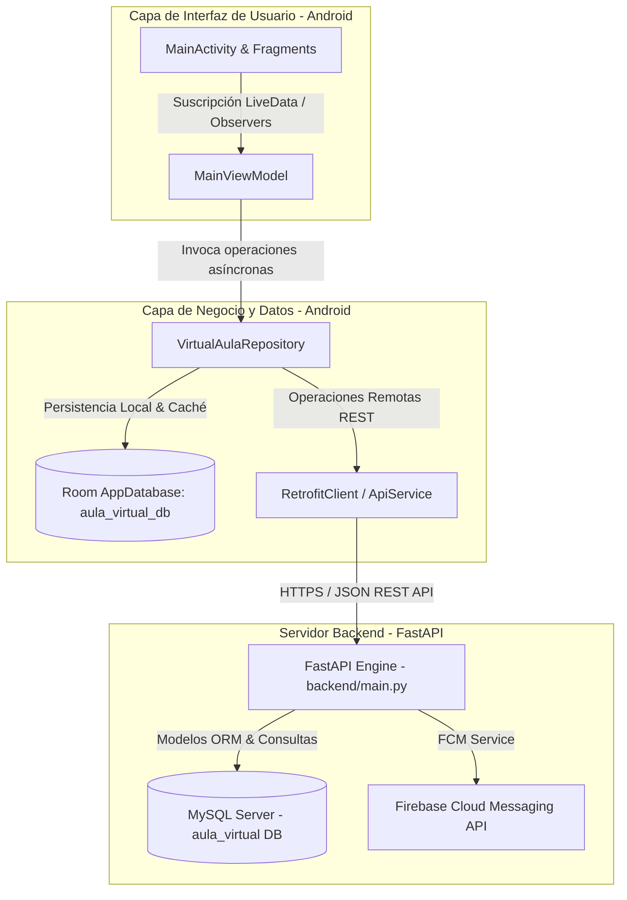

# 1. Introducción y Arquitectura

[📑 Índice](00_INDICE.md) | [Siguiente ➡️](02_roles_y_permisos.md)

Este documento describe el propósito del proyecto **Aula Virtual**, el problema que resuelve, las tecnologías utilizadas y la arquitectura técnica general de la solución (Cliente Android + Backend FastAPI + Base de datos MySQL).

---

## Tabla de Contenido
- [1.1 Propósito y Alcance Funcional](#11-propósito-y-alcance-funcional)
- [1.2 Stack Tecnológico y Versiones](#12-stack-tecnológico-y-versiones)
- [1.3 Requisitos del Sistema](#13-requisitos-del-sistema)
- [1.4 Arquitectura por Capas](#14-arquitectura-por-capas)
- [1.5 Estructura de Paquetes y Directorios](#15-estructura-de-paquetes-y-directorios)

---

## 1.1 Propósito y Alcance Funcional

**Aula Virtual** es una plataforma de gestión académica integral diseñada para instituciones educativas de nivel primario y secundario. Su objetivo principal es facilitar la comunicación, el seguimiento académico y la administración en tiempo real entre tres actores clave: **Administradores**, **Profesores** y **Encargados de Estudiantes** (Padres o Tutores).

### Problema que resuelve
- **Falta de visibilidad inmediata para los padres**: Los encargados pueden consultar las notas por período, el registro de asistencia diaria y las evaluaciones cuantitativas de conducta desde sus dispositivos móviles.
- **Gestión fragmentada docente**: Permite a los profesores calificar períodos (1 al 5), registrar asistencia por fecha/estado, evaluar criterios de conducta, importar/exportar plantillas masivas en Excel (.xlsx) y moderar foros de discusión por materia.
- **Centralización administrativa**: Permite gestionar usuarios (administradores, docentes, encargados), estudiantes asignados a encargados, materias, inscripciones, instalaciones físicas (aulas/laboratorios) y horarios semanales.

---

## 1.2 Stack Tecnológico y Versiones

A continuación se detallan las tecnologías, librerías y dependencias clave identificadas en el código fuente (`app/build.gradle.kts` y `backend/main.py`):

| Componente | Tecnología / Librería | Versión | Propósito / Uso |
| :--- | :--- | :--- | :--- |
| **Cliente Android** | Java 17 / Android SDK | Compile SDK 36, Target 35, Min 29 | Lenguaje principal y configuración del cliente móvil (`app/build.gradle.kts`) |
| **UI Framework** | Android XML / ViewBinding | Android Jetpack | Declaración de layouts y enlaces tipados a componentes UI |
| **Arquitectura UI** | Navigation Component / Lifecycle | `2.8.5` / `2.8.7` | Fragment Navigation (`nav_graph.xml`), ViewModel y LiveData |
| **Red & API** | Retrofit 2 + Gson + OkHttp | `2.11.0` / `4.12.0` | Cliente REST HTTP, deserialización JSON y logging de red |
| **Base de Datos Local** | Room Database | `2.6.1` | Caché local offline con persistencia SQLite (`aula_virtual_db`) |
| **Seguridad Android** | EncryptedSharedPreferences / BiometricPrompt | `1.1.0-alpha06` / `1.1.0` | Almacenamiento seguro de tokens/credenciales y login biométrico |
| **Push Notifications** | Firebase Cloud Messaging (FCM) | BoM `33.8.0` | Recepción de notificaciones push en tiempo real (`VirtualFirebaseMessagingService.java`) |
| **Manejo de Excel** | Apache POI (OOXML) | `5.2.3` | Generación e importación de plantillas `.xlsx` de notas y conducta |
| **Hashing Claves** | BCrypt | `0.10.2` | Hashing seguro de contraseñas de usuarios en el cliente Android y Backend |
| **Backend API** | FastAPI / Python | `3.10+` / FastAPI `0.100+` | Servidor Web REST asíncrono (`backend/main.py`) |
| **ORM Backend** | SQLAlchemy | `2.0+` | Mapeo objeto-relacional para interactuar con MySQL |
| **Base de Datos Server** | MySQL / MariaDB | `8.0+` | Almacenamiento persistente relacional (`backend/init.sql`) |
| **Servicio Web Admin** | HTML5 / JavaScript (Vanilla) / CSS3 | Standalone (`backend/web/`) | Panel de administración web ligero embebido |
| **Túnel de Red** | Cloudflare Tunnel | `cloudflared` | Exposición segura del backend local mediante HTTPS dinámico |

[⬆️ Volver al inicio del documento](#1-introducción-y-arquitectura)

---

## 1.3 Requisitos del Sistema

### Requisitos del Cliente (Dispositivo Móvil Android)
- **Sistema Operativo**: Android 10.0 (API Nivel 29) o superior.
- **Hardware Recomendado**: 2 GB de RAM, sensor de huella dactilar/rostro (opcional para biometría), cámara integrada (opcional para captura de avatares).
- **Conectividad**: Conexión a Internet (Wi-Fi o datos móviles) para sincronización con la API REST.

### Requisitos del Backend (Servidor)
- **Entorno Python**: Python 3.10+ con dependencias instaladas (`fastapi`, `uvicorn`, `sqlalchemy`, `pymysql`, `python-jose`, `passlib`, `pyfcm`, `openpyxl`).
- **Servidor de Base de Datos**: MySQL 8.0 o MariaDB 10.5+ escuchando en puerto 3306 (ej.: mediante XAMPP, WAMP o Docker).
- **Red**: Puerto 8000 libre para Uvicorn (`http://0.0.0.0:8000`) o ejecutable `cloudflared.exe` configurado para túneles HTTPS.

[⬆️ Volver al inicio del documento](#1-introducción-y-arquitectura)

---

## 1.4 Arquitectura por Capas

El proyecto implementa una arquitectura **MVVM (Model-View-ViewModel)** en el cliente Android, respaldada por un patrón de **Repositorio Unificado con Estrategia Offline-First / Sync**, conectada via REST a un backend **FastAPI en capas (API Endpoints -> SQLAlchemy ORM -> MySQL)**.



### Descripción de Capas
1. **Vista (UI)**: `MainActivity.java` y sub-pantallas basadas en `Fragment`. Se encargan exclusivamente del renderizado de componentes XML, manejo de eventos de usuario y actualización mediante `LiveData`.
2. **ViewModel**: `MainViewModel.java` coordina el estado de la aplicación, mantiene LiveData observables de listas de usuarios, materias, notas, notificaciones y errores, y sobrevive a cambios de configuración.
3. **Repository**: `VirtualAulaRepository.java` actúa como la única fuente de verdad (Single Source of Truth), manejando hilos en segundo plano (`Executors.newSingleThreadExecutor()`), coordinando lecturas/escrituras en Room local y llamadas HTTP con Retrofit.
4. **Data Sources**:
   - **Local**: `AppDatabase.java` (Room v9) almacena 19 entidades en la base de datos local SQLite (`aula_virtual_db`).
   - **Remoto**: `ApiService.java` ejecuta peticiones asíncronas HTTP a los endpoints de FastAPI.
5. **Backend Engine**: `backend/main.py` procesa los endpoints, aplica validaciones mediante esquemas Pydantic, gestiona la autenticación JWT / SHA-256 y ejecuta transacciones relacionales en MySQL.

[⬆️ Volver al inicio del documento](#1-introducción-y-arquitectura)

---

## 1.5 Estructura de Paquetes y Directorios

```
Aula Virtual/
├── app/                                        # Módulo principal Android
│   ├── src/main/
│   │   ├── AndroidManifest.xml                 # Declaración de actividades, permisos e intenciones
│   │   ├── java/com/aula/virtual/
│   │   │   ├── MainActivity.java               # Actividad contenedora principal y controlador de fragmentos
│   │   │   ├── data/                           # Capa de datos (Retrofit, Repository y Entidades)
│   │   │   │   ├── ApiService.java             # Interfaz de endpoints REST con Retrofit
│   │   │   │   ├── RetrofitClient.java         # Singleton y configurador de OkHttpClient / Gson
│   │   │   │   ├── VirtualAulaRepository.java  # Repositorio centralizador Room + REST API
│   │   │   │   ├── entity/                     # Entidades annotated de Room / Modelos
│   │   │   │   └── local/                      # Interfaces DAO y configuración de AppDatabase
│   │   │   ├── excel/                          # Módulo de importación/exportación POI Excel (.xlsx)
│   │   │   ├── service/                        # Servicios de fondo (Firebase Cloud Messaging)
│   │   │   ├── ui/                             # Controladores UI (Fragments, Adapters, ViewModels, Helpers)
│   │   │   └── util/                           # Clases utilitarias (PasswordHasher, etc.)
│   │   └── res/                                # Recursos gráficos, layouts, menús y valores XML
│   │       ├── drawable/                       # Iconos vectoriales y fondos redondeados
│   │       ├── layout/                         # Archivos XML de definición de pantalla y diálogos
│   │       ├── menu/                           # Menús de toolbar y navegación
│   │       ├── navigation/nav_graph.xml        # Grafo de navegación central del cliente
│   │       └── values/                         # Strings, colores, temas y estilos
├── backend/                                    # Servidor Backend FastAPI
│   ├── main.py                                 # Aplicación FastAPI, modelos ORM, Pydantic y endpoints API
│   ├── security.py                             # Utilidades de hashing, tokens JWT y autenticación
│   ├── init.sql                                # Script DDL de creación de la base de datos MySQL
│   ├── seed_demo.sql                           # Datos de prueba iniciales (Usuarios, Materias, Notas)
│   ├── migration_attendance.sql                # Script SQL de migración para módulo de Asistencia
│   ├── migration_conduct.sql                   # Script SQL de migración para módulo de Conducta
│   ├── run_backend.py                          # Script ejecutor de Uvicorn server
│   ├── run_tunnel_and_update_app.py            # Script automatizado para túnel Cloudflare y sync Android
│   └── web/                                    # Panel de administración Web independiente
│       ├── index.html                          # Interfaz HTML5 de administración web
│       ├── app.js                              # Lógica JS de cliente web (consumo API REST)
│       └── styles.css                          # Estilos CSS3 para el panel web
└── docs/                                       # Documentación técnica del proyecto (Generada)
```

[⬆️ Volver al inicio del documento](#1-introducción-y-arquitectura)

---
[📑 Índice](00_INDICE.md) | [Siguiente ➡️](02_roles_y_permisos.md)
