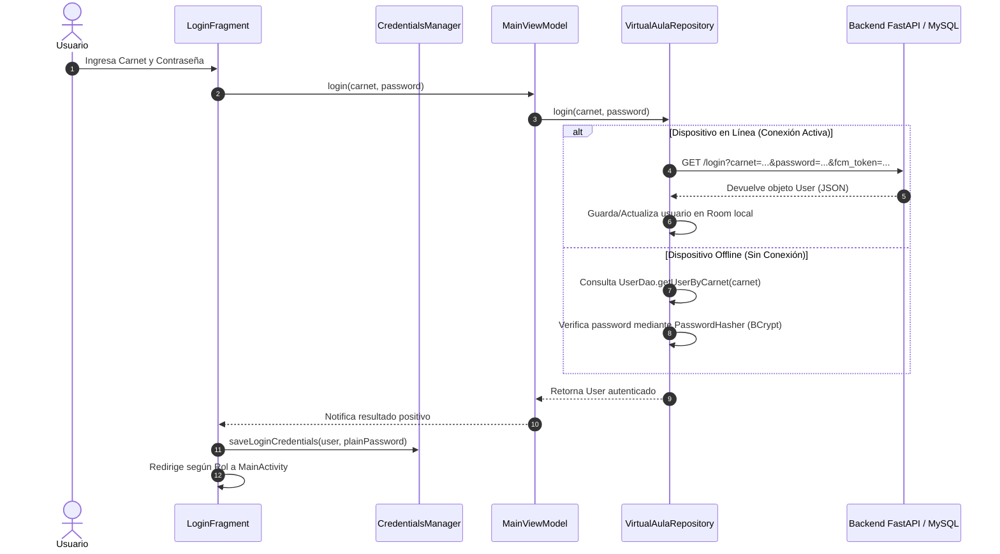

# 3. Autenticación y Seguridad

[⬅️ Anterior](02_roles_y_permisos.md) | [📑 Índice](00_INDICE.md) | [Siguiente ➡️](04_modelo_de_datos.md)

Este documento detalla el mecanismo completo de autenticación de usuarios, la gestión de sesiones seguras en el dispositivo móvil, la integración de biometría y un análisis de vulnerabilidades u observaciones de seguridad identificadas en el código fuente.

---

## Tabla de Contenido
- [3.1 Flujo General de Autenticación](#31-flujo-general-de-autenticación)
- [3.2 Almacenamiento Seguro (EncryptedSharedPreferences)](#32-almacenamiento-seguro-encryptedsharedpreferences)
- [3.3 Autenticación Biométrica (BiometricPrompt)](#33-autenticación-biométrica-biometricprompt)
- [3.4 Hashing de Contraseñas y Seguridad Backend](#34-hashing-de-contraseñas-y-seguridad-backend)
- [3.5 Observaciones y Riesgos de Seguridad Detectados](#35-observaciones-y-riesgos-de-seguridad-detectados)

---

## 3.1 Flujo General de Autenticación

El proceso de autenticación puede ejecutarse tanto en línea (contra el servidor FastAPI) como fuera de línea (mediante la base de datos local Room y credenciales encriptadas previamente).



[⬆️ Volver al inicio del documento](#3-autenticación-y-seguridad)

---

## 3.2 Almacenamiento Seguro (EncryptedSharedPreferences)

Ruta del archivo fuente: `app/src/main/java/com/aula/virtual/ui/CredentialsManager.java`

Para proteger la sesión del usuario en el dispositivo Android frente a lecturas no autorizadas o dispositivos rooteados, la aplicación utiliza la librería Jetpack `androidx.security.crypto.EncryptedSharedPreferences` cifrada mediante **AES-256 GCM**.

### Claves y Datos Almacenados
- `PREF_USER_ID`: Identificador entero del usuario logueado.
- `PREF_CARNET`: Código institucional del usuario.
- `PREF_NAME`: Nombre completo del usuario.
- `PREF_ROLE`: Rol asignado (`ADMIN`, `PROFESSOR`, `ENCARGADO`).
- `PREF_PASSWORD`: Contraseña cifrada en reposo para reconexión offline automática y validación biométrica.
- `PREF_SAVED_ACCOUNTS`: Cadena JSON cifrada que contiene la lista de múltiples cuentas guardadas en el dispositivo para cambio rápido de usuario.

```java
// Fragmento representativo de CredentialsManager.java
MasterKey masterKey = new MasterKey.Builder(context)
        .setKeyScheme(MasterKey.KeyScheme.AES256_GCM)
        .build();

SharedPreferences sharedPreferences = EncryptedSharedPreferences.create(
        context,
        "secure_user_credentials",
        masterKey,
        EncryptedSharedPreferences.PrefKeyEncryptionScheme.AES256_SIV,
        EncryptedSharedPreferences.PrefValueEncryptionScheme.AES256_GCM
);
```

[⬆️ Volver al inicio del documento](#3-autenticación-y-seguridad)

---

## 3.3 Autenticación Biométrica (BiometricPrompt)

Ruta del archivo fuente: `app/src/main/java/com/aula/virtual/ui/LoginFragment.java` y `CredentialsManager.java`

Si el dispositivo móvil cuenta con hardware de biometría (huella dactilar o reconocimiento facial) y el usuario ha iniciado sesión al menos una vez en el dispositivo, se activa la opción de inicio de sesión rápido mediante `BiometricPrompt`.

### Funcionamiento
1. Al abrir `LoginFragment.java`, el sistema invoca `CredentialsManager.hasStoredCredentials()`.
2. Si existen credenciales previas guardadas en `EncryptedSharedPreferences`, se muestra un botón con el icono de huella dactilar (`ic_fingerprint`).
3. Al presionar el botón o iniciarse automáticamente, se despliega el cuadro de diálogo nativo del sistema operativo mediante `BiometricPrompt`.
4. En caso de autenticación biométrica exitosa (`onAuthenticationSucceeded`), la app recupera el carnet y contraseña desencriptados de `EncryptedSharedPreferences` y ejecuta automáticamente el flujo de login sin requerir tecleo manual.

[⬆️ Volver al inicio del documento](#3-autenticación-y-seguridad)

---

## 3.4 Hashing de Contraseñas y Seguridad Backend

Archivos fuente: `app/src/main/java/com/aula/virtual/util/PasswordHasher.java` y `backend/security.py`

### Mecanismo de Hashing BCrypt
- **Algoritmo**: BCrypt con factor de costo (work factor) de 12 repeticiones.
- **Formato del Hash**: Cadena estándar `$2b$12$...` de 60 caracteres.
- **Verificación**: Tanto el cliente Android como el backend FastAPI validan las contraseñas comparando el texto plano ingresado contra la sal y el hash almacenado en la columna `users.password`.

```python
# Ubicación: backend/security.py
from passlib.context import CryptContext

pwd_context = CryptContext(schemes=["bcrypt"], deprecated="auto")

def verify_password(plain_password: str, hashed_password: str) -> bool:
    return pwd_context.verify(plain_password, hashed_password)

def get_password_hash(password: str) -> str:
    return pwd_context.hash(password)
```

[⬆️ Volver al inicio del documento](#3-autenticación-y-seguridad)

---

## 3.5 Observaciones y Riesgos de Seguridad Detectados

Durante la auditoría del código fuente, se identificaron las siguientes vulnerabilidades y aspectos a mejorar:

1. **Tráfico de Red sin Cifrar (Cleartext Traffic Enabled)**:
   - *Ubicación*: `app/src/main/AndroidManifest.xml` (`android:usesCleartextTraffic="true"`).
   - *Riesgo*: Permite comunicaciones HTTP en texto plano, exponiendo credenciales y datos sensibles a ataques Man-in-the-Middle (MitM) en redes Wi-Fi públicas.
   - *Recomendación*: Forzar conexiones HTTPS con TLS 1.3 en entornos de producción.

2. **Endpoint de Login por Método HTTP GET con Parámetros URL**:
   - *Ubicación*: `app/src/main/java/com/aula/virtual/data/ApiService.java` (`@GET("login")`) y `backend/main.py`.
   - *Riesgo*: Los parámetros `carnet` y `password` se transmiten en la Query String del URL (`/login?carnet=...&password=...`), provocando que las contraseñas queden registradas en los logs de acceso del servidor HTTP, proxies y proxy cache.
   - *Recomendación*: Migrar el inicio de sesión a un método `@POST("login")` enviando las credenciales dentro del cuerpo de la petición (`JSON Body`).

3. **Falta de Tokens JWT en las Cabeceras HTTP**:
   - *Ubicación*: `backend/main.py` y `ApiService.java`.
   - *Riesgo*: Aunque el backend incluye utilidades para JWT en `security.py`, los endpoints REST actuales no requieren un encabezado de autorización `Authorization: Bearer <token>`, confiando únicamente en los IDs enviados en los parámetros.
   - *Recomendación*: Implementar un interceptor OkHttp en Retrofit (`AuthInterceptor`) que adjunte el token JWT en cada solicitud y middleware de verificación en FastAPI.

4. **Fotografías de Perfil en Formato Base64 Extenso**:
   - *Ubicación*: Tabla `users` y `students` (columna `profile_image LONGTEXT`).
   - *Riesgo*: El envío directo de imágenes codificadas en Base64 de varios megabytes en los objetos JSON sobrecarga el ancho de banda y la memoria RAM del servidor y dispositivo.
   - *Recomendación*: Almacenar las imágenes en un directorio estático del servidor o bucket (S3) y guardar únicamente la URL relativa en la base de datos.

[⬆️ Volver al inicio del documento](#3-autenticación-y-seguridad)

---
[⬅️ Anterior](02_roles_y_permisos.md) | [📑 Índice](00_INDICE.md) | [Siguiente ➡️](04_modelo_de_datos.md)
