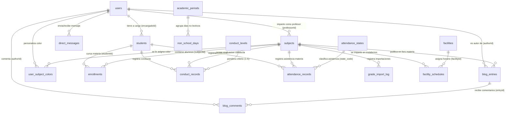

# 4. Modelo de Datos

[⬅️ Anterior](03_autenticacion_y_seguridad.md) | [📑 Índice](00_INDICE.md) | [Siguiente ➡️](05_backend_api.md)

Este documento describe el esquema relacional de la base de datos MySQL, el diagrama Entidad-Relación (ER), el detalle de cada tabla y la matriz de correspondencia completa entre la base de datos MySQL, los modelos ORM (SQLAlchemy), esquemas DTO (Pydantic), modelos Java (Gson) y entidades locales de Room.

---

## Tabla de Contenido
- [4.1 Diagrama Entidad-Relación (ER)](#41-diagrama-entidad-relación-er)
- [4.2 Detalle de Tablas de la Base de Datos](#42-detalle-de-tablas-de-la-base-de-datos)
- [4.3 Tabla de Correspondencia de Capas de Datos](#43-tabla-de-correspondencia-de-capas-de-datos)

---

## 4.1 Diagrama Entidad-Relación (ER)

Base de datos: `aula_virtual` (MySQL / Room SQLite).

[⬆️ Volver al inicio del documento](#4-modelo-de-datos)

---

## 4.2 Detalle de Tablas de la Base de Datos

Ubicación del script DDL: `backend/init.sql`

### 4.2.1 Tabla `users`
Almacena las cuentas de acceso con perfil de autenticación en la plataforma (Administradores, Profesores y Encargados).

| Columna | Tipo Dato | Nulo | Llave | Descripción |
| :--- | :--- | :---: | :---: | :--- |
| `id` | `INT` | NO | `PK` | Identificador único autoincremental del usuario. |
| `carnet` | `VARCHAR(10)` | NO | `UQ` | Código de identificación institucional (ej.: `ADM001`, `PROF001`, `ENC001`). |
| `name` | `VARCHAR(255)` | NO | - | Nombre completo del usuario. |
| `password` | `VARCHAR(255)` | NO | - | Hash BCrypt de la contraseña de acceso. |
| `role` | `VARCHAR(50)` | NO | - | Rol del usuario: `'ADMIN'`, `'PROFESSOR'` o `'ENCARGADO'`. |
| `address` | `TEXT` | SÍ | - | Dirección de residencia (aplica principalmente a Encargados). |
| `personal_email` | `VARCHAR(255)` | SÍ | - | Correo electrónico personal de contacto. |
| `profile_image` | `LONGTEXT` | SÍ | - | Fotografía de perfil en formato Base64. |
| `can_change_photo` | `BOOLEAN` | SÍ | - | Bandera (1/0) que indica si el usuario puede modificar su foto. |

---

### 4.2.2 Tabla `students`
Registra a los estudiantes menores de edad inscritos en la institución. Los alumnos no poseen cuenta de acceso propia; su tutor es referenciado por `encargadoId`.

| Columna | Tipo Dato | Nulo | Llave | Descripción |
| :--- | :--- | :---: | :---: | :--- |
| `id` | `INT` | NO | `PK` | Identificador único del estudiante. |
| `encargadoId` | `INT` | SÍ | `FK` | ID del usuario Encargado asignado (Referencia a `users.id`). |
| `carnet` | `VARCHAR(20)` | NO | `UQ` | Código o carnet del estudiante (ej.: `EST001`). |
| `name` | `VARCHAR(255)` | NO | - | Nombre completo del alumno menor de edad. |
| `grade` | `VARCHAR(100)` | SÍ | - | Grado, nivel o sección asignada. |
| `profile_image` | `LONGTEXT` | SÍ | - | Fotografía del estudiante en formato Base64. |

---

### 4.2.3 Tabla `subjects`
Representa las asignaturas o materias académicas ofrecidas por la institución.

| Columna | Tipo Dato | Nulo | Llave | Descripción |
| :--- | :--- | :---: | :---: | :--- |
| `id` | `INT` | NO | `PK` | Identificador único de la materia. |
| `code` | `VARCHAR(50)` | SÍ | `UQ` | Código institucional del curso (ej.: `MAT101`). |
| `name` | `VARCHAR(255)` | NO | - | Nombre completo de la materia (ej.: `Matemática II`). |
| `description` | `TEXT` | SÍ | - | Descripción pedagógica del programa de la materia. |
| `professorId` | `INT` | SÍ | `FK` | ID del profesor asignado (Referencia a `users.id`). |
| `section` | `VARCHAR(10)` | SÍ | - | Sección de la materia (ej.: `01`, `02`). |
| `color` | `VARCHAR(50)` | SÍ | - | Nombre del color predeterminado para tarjetas de UI (`BLUE`, `RED`, etc.). |

---

### 4.2.4 Tabla `enrollments`
Vincula a los estudiantes con las materias en las que están inscritos y registra sus calificaciones por período.

| Columna | Tipo Dato | Nulo | Llave | Descripción |
| :--- | :--- | :---: | :---: | :--- |
| `id` | `INT` | NO | `PK` | Identificador único de la inscripción. |
| `studentId` | `INT` | NO | `FK` | ID del estudiante (Referencia a `students.id`). |
| `subjectId` | `INT` | NO | `FK` | ID de la materia (Referencia a `subjects.id`). |
| `grade1` ... `grade5` | `DOUBLE` | SÍ | - | Calificaciones numéricas obtenidas en los períodos 1 a 5 (Escala 0.0 - 10.0). |
| `average` | `DOUBLE` | SÍ | - | Promedio ponderado acumulado calculable automáticamente por MySQL. |
| `color` | `VARCHAR(50)` | SÍ | - | Color representativo en la vista del estudiante. |

---

### 4.2.5 Tabla `conduct_records`
Registra la evaluación de la conducta y convivencia escolar por alumno, materia y período (criterios evaluados de 1 a 5).

| Columna | Tipo Dato | Nulo | Llave | Descripción |
| :--- | :--- | :---: | :---: | :--- |
| `id` | `INT` | NO | `PK` | Identificador del registro de conducta. |
| `studentId` | `INT` | NO | `FK` | Referencia al estudiante (`students.id`). |
| `subjectId` | `INT` | NO | `FK` | Referencia a la materia (`subjects.id`). |
| `period` | `TINYINT` | NO | - | Período académico (1 a 5). |
| `attention_participation` | `TINYINT` | SÍ | - | Calificación del criterio 1: Atención y Participación (1 a 5). |
| `rules_routines` | `TINYINT` | SÍ | - | Calificación del criterio 2: Cumplimiento de Normas y Rutinas (1 a 5). |
| `self_regulation_effort` | `TINYINT` | SÍ | - | Calificación del criterio 3: Autorregulación y Esfuerzo (1 a 5). |
| `respect_collaboration` | `TINYINT` | SÍ | - | Calificación del criterio 4: Respeto y Colaboración (1 a 5). |
| `responsibility` | `TINYINT` | SÍ | - | Calificación del criterio 5: Responsabilidad (1 a 5). |
| `observations` | `TEXT` | SÍ | - | Observaciones o comentarios cualitativos del docente. |
| `average` | `DOUBLE` | SÍ | - | Promedio calculado de los 5 criterios de conducta. |

---

### 4.2.6 Tabla `attendance_records`
Registra la asistencia física diaria de los estudiantes en cada materia.

| Columna | Tipo Dato | Nulo | Llave | Descripción |
| :--- | :--- | :---: | :---: | :--- |
| `id` | `INT` | NO | `PK` | Identificador del registro de asistencia. |
| `studentId` | `INT` | NO | `FK` | Referencia al estudiante (`students.id`). |
| `subjectId` | `INT` | NO | `FK` | Referencia a la materia (`subjects.id`). |
| `date` | `VARCHAR(10)`| NO | - | Fecha de la toma de asistencia en formato ISO `YYYY-MM-DD`. |
| `state_code` | `VARCHAR(20)`| NO | `FK` | Estado de asistencia: `'PRESENT'`, `'ABSENT'`, `'LATE'`, `'PERMIT'`. |
| `notes` | `TEXT` | SÍ | - | Justificaciones o notas adicionales. |

---

### 4.2.7 Tabla `facilities` y `facility_schedules`
Almacenan los espacios físicos institucionales (Aulas, Laboratorios, Canchas) y sus horarios asignados por materia y día de la semana (`1=Lunes` a `7=Domingo`).

---

### 4.2.8 Tablas de Foros `blog_entries` y `blog_comments`
Permiten la publicación de temas de discusión por materia y la interacción de comentarios entre docentes y encargados.

---

### 4.2.9 Tabla `direct_messages`
Almacena el historial de mensajería privada en tiempo real entre usuarios (mensajes, fecha/hora, estado de lectura `is_read` e identificador de sala de chat `chat_room_id`).

---

### 4.2.10 Tablas Complementarias
- `academic_periods`: Define los 5 períodos escolares con fecha inicio/fin y estado activo.
- `non_school_days`: Lista de días asuetos/feriados asociados a un período.
- `grade_import_log`: Auditoría de importaciones masivas de planillas Excel.
- `notifications`: Registro de avisos y notificaciones push enviadas mediante FCM.
- `user_subject_colors`: Preferencias de color por usuario para personalización visual.
- `modification_logs`: Historial de auditoría para rastrear cambios en campos sensibles.

[⬆️ Volver al inicio del documento](#4-modelo-de-datos)

---

## 4.3 Tabla de Correspondencia de Capas de Datos

Esta matriz detalla la equivalencia entre las tablas físicas de MySQL, los modelos SQLAlchemy del servidor Python, los esquemas de transferencia Pydantic, los POJOs Java de Android y las entidades de Room SQLite:

| Tabla MySQL | Modelo ORM SQLAlchemy (`backend/main.py`) | DTO Pydantic (`backend/main.py`) | Clase Java (`com.aula.virtual.data.entity`) | Entidad Room (`com.aula.virtual.data.local`) |
| :--- | :--- | :--- | :--- | :--- |
| `users` | `UserModel` | `UserOut` / `UserCreate` | `User.java` | `UserDao` (`User`) |
| `students` | `StudentModel` | `StudentSchema` | `Student.java` | `StudentDao` (`Student`) |
| `subjects` | `SubjectModel` | `Subject` | `Subject.java` | `SubjectDao` (`Subject`) |
| `enrollments` | `EnrollmentModel` | `Enrollment` | `Enrollment.java` | `EnrollmentDao` (`Enrollment`) |
| `conduct_records` | `ConductRecordModel` | `ConductRecordSchema` | `ConductRecord.java` | `ConductRecordDao` (`ConductRecord`) |
| `attendance_records`| `AttendanceRecordModel`| `AttendanceRecordSchema` | `AttendanceRecord.java` | `AttendanceRecordDao` (`AttendanceRecord`)|
| `facilities` | `FacilityModel` | `Facility` | `Facility.java` | `FacilityDao` (`Facility`) |
| `facility_schedules`| `FacilityScheduleModel`| `FacilitySchedule` | `FacilitySchedule.java` | `FacilityScheduleDao` (`FacilitySchedule`)|
| `blog_entries` | `BlogEntryModel` | `BlogEntry` | `BlogEntry.java` | `BlogDao` (`BlogEntry`) |
| `blog_comments` | `BlogCommentModel` | `CommentInfo` | `BlogComment.java` | `BlogDao` (`BlogComment`) |
| `direct_messages` | `DirectMessageModel` | `DirectMessageSchema` | `DirectMessage.java` | `DirectMessageDao` (`DirectMessage`) |
| `notifications` | `NotificationModel` | `NotificationSchema` | `Notification.java` | `NotificationDao` (`Notification`) |
| `grade_import_log` | `GradeImportLogModel` | `GradeImportLogSchema` | `GradeImportLog.java` | `GradeImportLogDao` (`GradeImportLog`) |
| `user_subject_colors`| `UserSubjectColorModel`| N/A (Map response) | `UserSubjectColor.java` | `UserSubjectColorDao` (`UserSubjectColor`)|
| `modification_logs`| `ModificationLogModel`| `ModificationLogSchema` | `ModificationLog.java` | `ModificationLogDao` (`ModificationLog`)|

[⬆️ Volver al inicio del documento](#4-modelo-de-datos)

---
[⬅️ Anterior](03_autenticacion_y_seguridad.md) | [📑 Índice](00_INDICE.md) | [Siguiente ➡️](05_backend_api.md)
