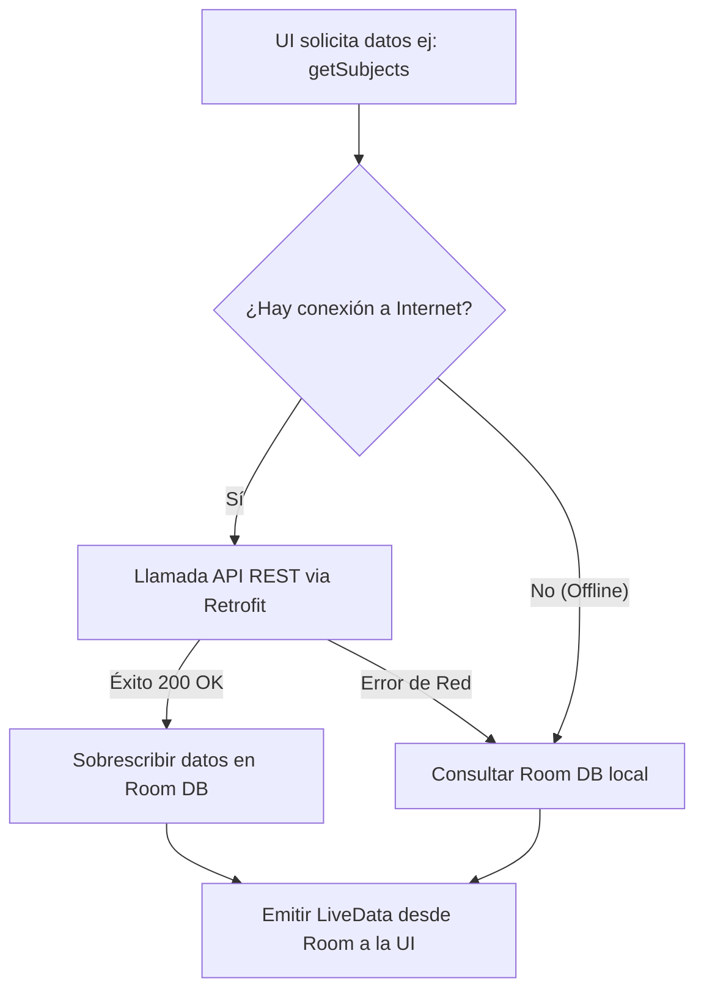

# 6. Gestión de Datos en Android

[⬅️ Anterior](05_backend_api.md) | [📑 Índice](00_INDICE.md) | [Siguiente ➡️](07_repositorios_y_viewmodels.md)

Este documento detalla las dos fuentes de datos utilizadas por la aplicación Android: el cliente de red HTTP con **Retrofit 2** y la base de datos relacional local con **Room Database**, así como la estrategia de sincronización offline/online.

---

## Tabla de Contenido
- [PARTE A: RED (RETROFIT)](#parte-a-red-retrofit)
  - [6.1 Configuración de Retrofit, Gson y OkHttp](#61-configuración-de-retrofit-gson-y-okhttp)
  - [6.2 Interfaz ApiService](#62-interfaz-apiservice)
  - [6.3 Clases Modelo Request/Response DTO](#63-clases-modelo-requestresponse-dto)
  - [6.4 Manejo de Timeouts y Errores de Red](#64-manejo-de-timeouts-y-errores-de-red)
- [PARTE B: PERSISTENCIA LOCAL (ROOM)](#parte-b-persistencia-local-room)
  - [6.5 Clase AppDatabase y Configuración](#65-clase-appdatabase-y-configuración)
  - [6.6 Entidades y DAOs de Room](#66-entidades-y-daos-de-room)
  - [6.7 Estrategia de Sincronización Offline/Online](#67-estrategia-de-sincronización-offlineonline)
- [6.8 Matriz Resumen de Almacenamiento](#68-matriz-resumen-de-almacenamiento)

---

## PARTE A: RED (RETROFIT)

### 6.1 Configuración de Retrofit, Gson y OkHttp

Ruta del archivo fuente: `app/src/main/java/com/aula/virtual/data/RetrofitClient.java`

El cliente de red se implementa como un Singleton con configuración parametrizable dinámicamente mediante `SharedPreferences`.

### Características Principales
- **URL Base Dinámica**: Permite cambiar la URL base en tiempo de ejecución (ej.: IP local `http://192.168.1.10:8000/` o dominio Cloudflare `https://...trycloudflare.com/`).
- **OkHttpClient Personalizado**: Incluye un `HttpLoggingInterceptor` con nivel `BODY` para depuración de cabeceras y cuerpos JSON en logcat.
- **Timeouts**: Configurado con un tiempo de espera de conexión, lectura y escritura de 30 segundos.
- **Conversor Gson**: Registra `GsonConverterFactory.create(gson)` tolerante con formatos nulos y fechas.

```java
// Ubicación: app/src/main/java/com/aula/virtual/data/RetrofitClient.java
public static synchronized ApiService getApiService(Context context) {
    if (retrofit == null || !currentBaseUrl.equals(getBaseUrl(context))) {
        currentBaseUrl = getBaseUrl(context);
        OkHttpClient client = new OkHttpClient.Builder()
                .connectTimeout(30, TimeUnit.SECONDS)
                .readTimeout(30, TimeUnit.SECONDS)
                .writeTimeout(30, TimeUnit.SECONDS)
                .addInterceptor(new HttpLoggingInterceptor().setLevel(HttpLoggingInterceptor.Level.BODY))
                .build();

        retrofit = new Retrofit.Builder()
                .baseUrl(currentBaseUrl)
                .client(client)
                .addConverterFactory(GsonConverterFactory.create())
                .build();
    }
    return retrofit.create(ApiService.class);
}
```

[⬆️ Volver al inicio del documento](#6-gestión-de-datos-en-android)

---

### 6.2 Interfaz ApiService

Ruta del archivo fuente: `app/src/main/java/com/aula/virtual/data/ApiService.java`

La interfaz `ApiService` define todos los métodos síncronos y asíncronos que retornan objetos de tipo `retrofit2.Call<T>`. Contiene más de 45 métodos mapping a los endpoints de FastAPI (ver resumen de llamadas en [5. API Backend (FastAPI)](05_backend_api.md#52-catálogo-completo-de-endpoints-rest)).

[⬆️ Volver al inicio del documento](#6-gestión-de-datos-en-android)

---

### 6.3 Clases Modelo Request/Response DTO

Ubicación: `app/src/main/java/com/aula/virtual/data/`

Además de las entidades de dominio, se utilizan clases compuestas para deserialización de respuestas específicas:
- `StudentGradeInfo.java`: Agrupa el nombre de la materia, nombre del profesor, calificaciones (1 a 5), promedio y color asignado.
- `StudentInSubjectInfo.java`: Representa la fila de la planilla del docente con datos del alumno (`studentId`, `carnet`, `name`) y sus notas.
- `ChatRoomInfo.java`: Modela el resumen de una sala de conversación privada (`chatRoomId`, `otherUserId`, `otherUserName`, `otherUserProfileImage`, `lastMessage`, `unreadCount`).
- `ScheduleInfo.java`: Modela el horario asignado indicando materia, profesor, instalación, día de la semana y horas inicio/fin.
- `CommentInfo.java`: DTO para respuestas de comentarios en el foro con avatar y nombre del autor.

[⬆️ Volver al inicio del documento](#6-gestión-de-datos-en-android)

---

### 6.4 Manejo de Timeouts y Errores de Red

Todas las llamadas de red se ejecutan en segundo plano dentro de `VirtualAulaRepository.java` utilizando bloques `enqueue(new Callback<T>() {...})` o ejecutores en hilo secundario:
- En caso de fallo de red (`onFailure` o `IOException`), el repositorio captura la excepción, conmuta el indicador de estado a offline y consulta inmediatamente la base de datos Room para responder con los datos cacheados.
- Los errores HTTP (4xx o 5xx) leen el `response.errorBody()` y notifican a la UI mediante un `LiveData<String>` de mensajes de error.

[⬆️ Volver al inicio del documento](#6-gestión-de-datos-en-android)

---

## PARTE B: PERSISTENCIA LOCAL (ROOM)

### 6.5 Clase AppDatabase y Configuración

Ruta del archivo fuente: `app/src/main/java/com/aula/virtual/data/local/AppDatabase.java`

`AppDatabase` es una clase abstracta que extiende `RoomDatabase`. Representa la base de datos SQLite local denominada `"aula_virtual_db"`.

### Especificaciones de Room
- **Versión Actual**: `9`
- **Export Schema**: `false`
- **Entidades Registradas**: 19 entidades (`User`, `Student`, `Subject`, `Facility`, `Enrollment`, `FacilitySchedule`, `BlogEntry`, `BlogComment`, `Notification`, `UserSubjectColor`, `DirectMessage`, `GradeImportLog`, `ConductLevel`, `ConductRecord`, `AcademicPeriod`, `NonSchoolDay`, `AttendanceState`, `AttendanceRecord`, `ModificationLog`).
- **Estrategia de Migración**: `.fallbackToDestructiveMigration()`
- **Callback `onCreate`**: Ejecuta el método `seedInitialData(db)` para preinsertar los niveles de conducta (1 a 5) y los estados de asistencia (`PRESENT`, `ABSENT`, `LATE`, `PERMIT`).

[⬆️ Volver al inicio del documento](#6-gestión-de-datos-en-android)

---

### 6.6 Entidades y DAOs de Room

Ubicación: `app/src/main/java/com/aula/virtual/data/entity/` y `com/aula/virtual/data/local/`

Cada tabla de SQLite posee su respectivo Data Access Object (DAO) anotado con `@Dao`. Ejemplos destacados de consultas SQL compuestas:

1. **`UserDao.java`**:
   - `@Query("SELECT * FROM users WHERE carnet = :carnet LIMIT 1")`
   - `@Query("SELECT * FROM users WHERE role = :role")`
2. **`StudentDao.java`**:
   - `@Query("SELECT * FROM students WHERE encargadoId = :encargadoId")`
3. **`EnrollmentDao.java`**:
   - `@Query("SELECT * FROM enrollments WHERE studentId = :studentId")`
   - `@Query("SELECT * FROM enrollments WHERE subjectId = :subjectId")`
4. **`AttendanceRecordDao.java`**:
   - `@Query("SELECT * FROM attendance_records WHERE subjectId = :subjectId AND date = :date")`
5. **`ConductRecordDao.java`**:
   - `@Query("SELECT * FROM conduct_records WHERE studentId = :studentId AND subjectId = :subjectId AND period = :period")`

[⬆️ Volver al inicio del documento](#6-gestión-de-datos-en-android)

---

### 6.7 Estrategia de Sincronización Offline/Online

El proyecto utiliza una estrategia de **Caché con Actualización en Red (Cache-First + Network Refresh)** manejada por `VirtualAulaRepository.java`:



- **Operaciones de Lectura**: Devuelven inmediatamente los datos locales desde Room mientras se efectúa la llamada en segundo plano al servidor. Al recibir la respuesta HTTP 200 OK, los registros en Room son actualizados, lo que dispara la actualización reactiva en la UI.
- **Operaciones de Escritura (Crear/Editar)**: Se intentan enviar a la API REST. Si el dispositivo no tiene red, se guardan localmente en Room y se registran en la entidad `ModificationLog` para su sincronización posterior cuando se restablezca la conectividad.

[⬆️ Volver al inicio del documento](#6-gestión-de-datos-en-android)

---

## 6.8 Matriz Resumen de Almacenamiento

Esta tabla resume qué tipo de información reside en cada capa de persistencia del dispositivo Android:

| Categoría de Datos | API REST (FastAPI/MySQL) | Room DB Local SQLite | EncryptedSharedPreferences |
| :--- | :---: | :---: | :---: |
| **Credenciales y Tokens de Sesión** | ❌ (Solo valida) | ❌ No | ✅ Cifrado AES-256 |
| **Preferencias de Tema / Config Server** | ❌ No | ❌ No | ✅ SharedPreferences |
| **Listado de Usuarios / Estudiantes / Materias** | ✅ Fuente Primaria | ✅ Caché Offline | ❌ No |
| **Calificaciones, Conducta y Asistencia** | ✅ Fuente Primaria | ✅ Caché Offline | ❌ No |
| **Historial de Chat y Mensajes Directos** | ✅ Fuente Primaria | ✅ Caché Local | ❌ No |
| **Plantillas Excel de Notas (.xlsx)** | ❌ No | ❌ No | ❌ Archivo temporal |

[⬆️ Volver al inicio del documento](#6-gestión-de-datos-en-android)

---
[⬅️ Anterior](05_backend_api.md) | [📑 Índice](00_INDICE.md) | [Siguiente ➡️](07_repositorios_y_viewmodels.md)
