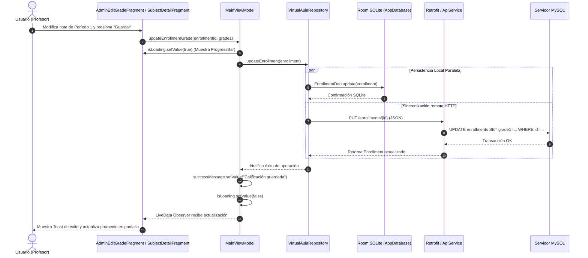

# 7. Repositorios y ViewModels

[⬅️ Anterior](06_datos_en_android.md) | [📑 Índice](00_INDICE.md) | [Siguiente ➡️](08a_ui_compartida.md)

Este documento describe la capa de arquitectura MVVM intermedia en Android, detallando el funcionamiento del repositorio central `VirtualAulaRepository` y la gestión de estado con `MainViewModel`.

---

## Tabla de Contenido
- [7.1 Repositorio Central (VirtualAulaRepository)](#71-repositorio-central-virtualaularepository)
- [7.2 Gestión de Estado con MainViewModel](#72-gestión-de-estado-con-mainviewmodel)
- [7.3 Diagrama de Flujo de Datos Extremo a Extremo](#73-diagrama-de-flujo-de-datos-extremo-a-extremo)

---

## 7.1 Repositorio Central (VirtualAulaRepository)

Ruta del archivo fuente: `app/src/main/java/com/aula/virtual/data/VirtualAulaRepository.java`

`VirtualAulaRepository` es la clase central que coordina el flujo de información en el cliente Android. Implementa el patrón **Single Source of Truth** delegando las llamadas de red a `ApiService` (Retrofit) y el almacenamiento local a `AppDatabase` (Room).

### Responsabilidades Clave
- **Ejecución Asíncrona**: Utiliza un pool de hilos secundario (`ExecutorService executor = Executors.newSingleThreadExecutor()`) para evitar el bloqueo del hilo principal de interfaz de usuario (UI Thread).
- **Mapeo y Transformación**: Convierte las respuestas JSON obtenidas de Retrofit en entidades locales e inserta/actualiza masivamente los registros en SQLite usando los DAOs de Room.
- **Auditoría de Cambios**: Invoca `ModificationLogManager` para registrar cualquier edición de notas, conducta o datos de usuario realizada en modo fuera de línea.

### Métodos Principales por Módulo

| Módulo | Métodos Representativos | Descripción |
| :--- | :--- | :--- |
| **Autenticación** | `login(...)`, `saveUserLocal(...)` | Autentica credenciales y sincroniza el perfil devuelto en Room. |
| **Usuarios** | `getStudents(...)`, `getProfessors(...)`, `createUser(...)` | Gestiona el CRUD de usuarios por rol. |
| **Estudiantes** | `getStudentsByEncargado(...)`, `createStudent(...)` | Consulta y crea alumnos vinculados a un tutor. |
| **Materias** | `getSubjects(...)`, `getSubjectsByProfessor(...)` | Sincroniza la lista de asignaturas y sus profesores asignados. |
| **Notas** | `getGradeInfoForStudent(...)`, `updateEnrollment(...)` | Obtener y actualizar notas de períodos 1 a 5. |
| **Asistencia** | `getAttendanceRecords(...)`, `saveAttendanceRecord(...)` | Consulta e inserción de asistencia diaria por fecha. |
| **Conducta** | `getConductRecords(...)`, `saveConductRecord(...)` | Evaluación de los 5 criterios cuantitativos de conducta. |
| **Mensajería** | `getChatRooms(...)`, `getDirectMessages(...)`, `sendMessage(...)` | Cargar conversaciones y enviar mensajes privados. |
| **Notificaciones**| `getNotifications(...)`, `createNotification(...)` | Consultar e interactuar con notificaciones push/avisos. |

[⬆️ Volver al inicio del documento](#7-repositorios-y-viewmodels)

---

## 7.2 Gestión de Estado con MainViewModel

Ruta del archivo fuente: `app/src/main/java/com/aula/virtual/ui/MainViewModel.java`

`MainViewModel` extiende de `AndroidViewModel`. Actúa como el puente entre los fragmentos de la interfaz de usuario y `VirtualAulaRepository`. Almacena y expone el estado de la UI utilizando `MutableLiveData` y `LiveData`.

### Principales LiveData Expuestos

```java
// Ubicación: app/src/main/java/com/aula/virtual/ui/MainViewModel.java
private final MutableLiveData<User> currentUser = new MutableLiveData<>();
private final MutableLiveData<List<User>> usersList = new MutableLiveData<>();
private final MutableLiveData<List<Student>> studentsList = new MutableLiveData<>();
private final MutableLiveData<List<Subject>> subjectsList = new MutableLiveData<>();
private final MutableLiveData<List<StudentGradeInfo>> studentGrades = new MutableLiveData<>();
private final MutableLiveData<List<AttendanceRecord>> attendanceRecords = new MutableLiveData<>();
private final MutableLiveData<List<ConductRecord>> conductRecords = new MutableLiveData<>();
private final MutableLiveData<List<ChatRoomInfo>> chatRooms = new MutableLiveData<>();
private final MutableLiveData<List<DirectMessage>> directMessages = new MutableLiveData<>();
private final MutableLiveData<List<Notification>> notificationsList = new MutableLiveData<>();
private final MutableLiveData<Boolean> isLoading = new MutableLiveData<>(false);
private final MutableLiveData<String> errorMessage = new MutableLiveData<>();
private final MutableLiveData<String> successMessage = new MutableLiveData<>();
```

### Funciones destacadas en MainViewModel
- `loadDashboardDataForRole(String role, int userId)`: Detecta el rol del usuario logueado y dispara la carga paralela de listas relevantes (ej. materias asignadas si es profesor, hijos asignados si es encargado).
- `updateStudentGrade(...)`: Actualiza la nota de un período específico, recalcula el promedio en tiempo real y notifica el cambio al repositorio.
- `importGradesFromExcel(...)`: Invoca a `GradeExcelImporter` para procesar un archivo `.xlsx` seleccionado por el usuario en hilo de fondo.
- `backupDatabaseToLocalJson(...)`: Invoca a `LocalDatabaseBackupManager` para exportar la base de datos completa de Room a un archivo JSON de respaldo.

[⬆️ Volver al inicio del documento](#7-repositorios-y-viewmodels)

---

## 7.3 Diagrama de Flujo de Datos Extremo a Extremo

Este diagrama ilustra la trayectoria completa de un evento desencadenado desde la interfaz de usuario (ejemplo: guardar una calificación) hasta la persistencia en el backend y la actualización reactiva de la pantalla:



[⬆️ Volver al inicio del documento](#7-repositorios-y-viewmodels)

---
[⬅️ Anterior](06_datos_en_android.md) | [📑 Índice](00_INDICE.md) | [Siguiente ➡️](08a_ui_compartida.md)
