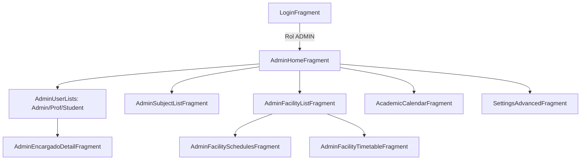
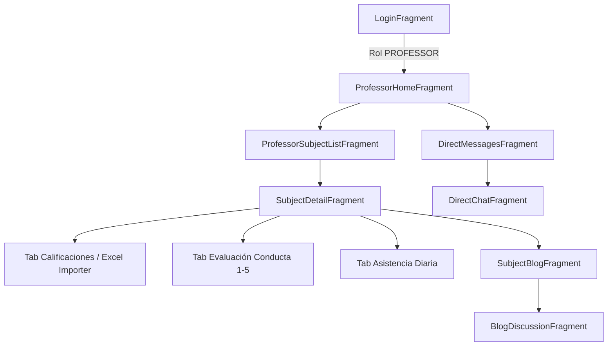
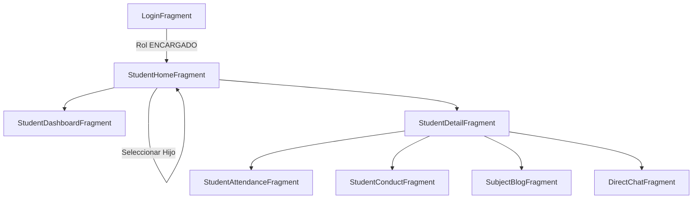

# 9. Navegación en Android

[⬅️ Anterior](08d_ui_estudiante_encargado.md) | [📑 Índice](00_INDICE.md) | [Siguiente ➡️](10_catalogo_clases_y_metodos.md)

Este documento describe la arquitectura de navegación implementada con Android Jetpack **Navigation Component**, los grafos de pantalla, los menús por rol y los diagramas de flujo de usuario.

---

## Tabla de Contenido
- [9.1 Configuración de Navigation Component (nav_graph.xml)](#91-configuración-de-navigation-component-nav_graphxml)
- [9.2 Menús de Navegación por Rol (Drawer Menus)](#92-menús-de-navegación-por-rol-drawer-menus)
- [9.3 Diagramas Mermaid de Flujos de Pantalla](#93-diagramas-mermaid-de-flujos-de-pantalla)

---

## 9.1 Configuración de Navigation Component (nav_graph.xml)

Ruta del archivo fuente: `app/src/main/res/navigation/nav_graph.xml`

La navegación en el cliente Android es administrada de manera declarativa centralizada mediante `nav_graph.xml`. `MainActivity.java` alberga el contenedor `NavHostFragment` (`R.id.nav_host_fragment`).

### Destinos Principales Definidos
- `loginFragment` (`com.aula.virtual.ui.LoginFragment`)
- `adminHomeFragment` (`com.aula.virtual.ui.AdminHomeFragment`)
- `professorHomeFragment` (`com.aula.virtual.ui.ProfessorHomeFragment`)
- `studentHomeFragment` (`com.aula.virtual.ui.StudentHomeFragment`)
- `studentDashboardFragment` (`com.aula.virtual.ui.StudentDashboardFragment`)
- `studentDetailFragment` (`com.aula.virtual.ui.StudentDetailFragment`)
- `studentAttendanceFragment` (`com.aula.virtual.ui.StudentAttendanceFragment`)
- `studentConductFragment` (`com.aula.virtual.ui.StudentConductFragment`)
- `subjectDetailFragment` (`com.aula.virtual.ui.SubjectDetailFragment`)
- `subjectBlogFragment` (`com.aula.virtual.ui.SubjectBlogFragment`)
- `blogDiscussionFragment` (`com.aula.virtual.ui.BlogDiscussionFragment`)
- `directMessagesFragment` (`com.aula.virtual.ui.DirectMessagesFragment`)
- `directChatFragment` (`com.aula.virtual.ui.DirectChatFragment`)
- `notificationListFragment` (`com.aula.virtual.ui.NotificationListFragment`)
- `studentProfileFragment` (`com.aula.virtual.ui.StudentProfileFragment`)
- `settingsFragment` (`com.aula.virtual.ui.SettingsFragment`)
- `settingsAdvancedFragment` (`com.aula.virtual.ui.SettingsAdvancedFragment`)
- `academicCalendarFragment` (`com.aula.virtual.ui.AcademicCalendarFragment`)

### Paso de Argumentos (Bundle / Safe Args)
- `studentId` (`integer`): Transfiere el ID del alumno seleccionado hacia el detalle de notas, asistencia y conducta.
- `subjectId` (`integer`): Identificador de la materia al ingresar a `SubjectDetailFragment` o `SubjectBlogFragment`.
- `chatRoomId` / `contactUserId` (`integer`): Parámetros para abrir la conversación privada en `DirectChatFragment`.
- `blogEntryId` (`integer`): ID de la entrada del foro para abrir el hilo de comentarios en `BlogDiscussionFragment`.

[⬆️ Volver al inicio del documento](#9-navegación-en-android)

---

## 9.2 Menús de Navegación por Rol (Drawer Menus)

Ubicación: `app/src/main/res/menu/`

`MainActivity.java` infla de forma dinámica el menú lateral (`NavigationView`) según el rol del usuario autenticado:

1. **Menú Administrador (`drawer_menu_admin.xml`)**:
   - Inicio Administrador (`adminHomeFragment`)
   - Usuarios (Admins, Profesores, Estudiantes)
   - Materias e Inscripciones (`adminSubjectListFragment`)
   - Instalaciones y Horarios (`adminFacilityListFragment`)
   - Calendario Académico (`academicCalendarFragment`)
   - Notificaciones (`notificationListFragment`)
   - Ajustes / Avanzado (`settingsFragment`)

2. **Menú Profesor (`drawer_menu_professor.xml`)**:
   - Inicio Profesor (`professorHomeFragment`)
   - Mis Asignaturas (`professorSubjectListFragment`)
   - Mensajería Directa (`directMessagesFragment`)
   - Notificaciones (`notificationListFragment`)
   - Calendario Académico (`academicCalendarFragment`)
   - Mi Perfil (`studentProfileFragment`)

3. **Menú Encargado / Estudiante (`drawer_menu_student.xml`)**:
   - Inicio Encargado (`studentHomeFragment`)
   - Rendimiento / Dashboard (`studentDashboardFragment`)
   - Mensajería Directa (`directMessagesFragment`)
   - Notificaciones (`notificationListFragment`)
   - Calendario Académico (`academicCalendarFragment`)
   - Mi Perfil (`studentProfileFragment`)

[⬆️ Volver al inicio del documento](#9-navegación-en-android)

---

## 9.3 Diagramas Mermaid de Flujos de Pantalla

### 9.3.1 Flujo del Administrador (`ADMIN`)

### 9.3.2 Flujo del Profesor (`PROFESSOR`)

### 9.3.3 Flujo del Encargado (`ENCARGADO`)

[⬆️ Volver al inicio del documento](#9-navegación-en-android)

---
[⬅️ Anterior](08d_ui_estudiante_encargado.md) | [📑 Índice](00_INDICE.md) | [Siguiente ➡️](10_catalogo_clases_y_metodos.md)
