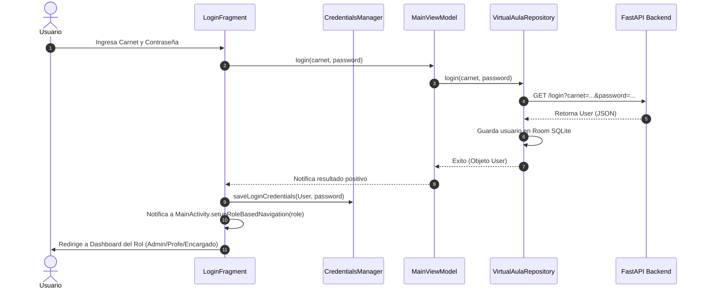
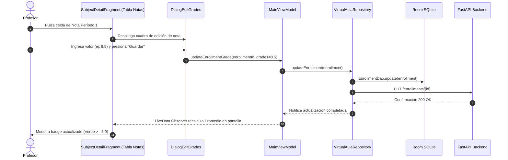
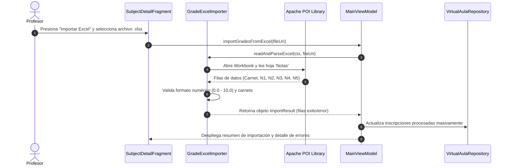
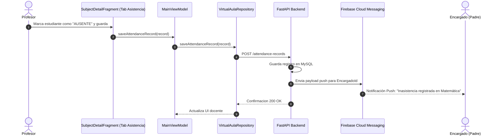

# 11. Flujos de Negocio Principales

[⬅️ Anterior](10_catalogo_clases_y_metodos.md) | [📑 Índice](00_INDICE.md) | [Siguiente ➡️](12_recursos_y_configuracion.md)

Este documento detalla los flujos de negocio end-to-end más críticos de la aplicación **Aula Virtual**, incluyendo diagramas de secuencia Mermaid para ilustrar la interacción entre componentes UI, ViewModels, Repositorio, Base de Datos local y Servidor Backend.

---

## Tabla de Contenido
- [11.1 Flujo 1: Autenticación y Carga de Sesión](#111-flujo-1-autenticación-y-carga-de-sesión)
- [11.2 Flujo 2: Ingreso y Actualización de Calificaciones](#112-flujo-2-ingreso-y-actualización-de-calificaciones)
- [11.3 Flujo 3: Importación Masiva de Notas desde Excel (.xlsx)](#113-flujo-3-importación-masiva-de-notas-desde-excel-xlsx)
- [11.4 Flujo 4: Registro de Asistencia y Emisión de Alertas FCM](#114-flujo-4-registro-de-asistencia-y-emisión-de-alertas-fcm)

---

## 11.1 Flujo 1: Autenticación y Carga de Sesión

Este flujo describe el proceso desde que el usuario ingresa sus credenciales en `LoginFragment` hasta la configuración del panel lateral de navegación según su rol.

[⬆️ Volver al inicio del documento](#11-flujos-de-negocio-principales)

---

## 11.2 Flujo 2: Ingreso y Actualización de Calificaciones

Describe el procedimiento mediante el cual un docente modifica la nota de un estudiante para un período determinado.

[⬆️ Volver al inicio del documento](#11-flujos-de-negocio-principales)

---

## 11.3 Flujo 3: Importación Masiva de Notas desde Excel (.xlsx)

Detalla el procesamiento automatizado de planillas de calificaciones cargadas por el docente.

[⬆️ Volver al inicio del documento](#11-flujos-de-negocio-principales)

---

## 11.4 Flujo 4: Registro de Asistencia y Emisión de Alertas FCM

Muestra cómo se registra la lista diaria de clase y se envía una notificación push en tiempo real al dispositivo móvil del Encargado.

[⬆️ Volver al inicio del documento](#11-flujos-de-negocio-principales)

---
[⬅️ Anterior](10_catalogo_clases_y_metodos.md) | [📑 Índice](00_INDICE.md) | [Siguiente ➡️](12_recursos_y_configuracion.md)
